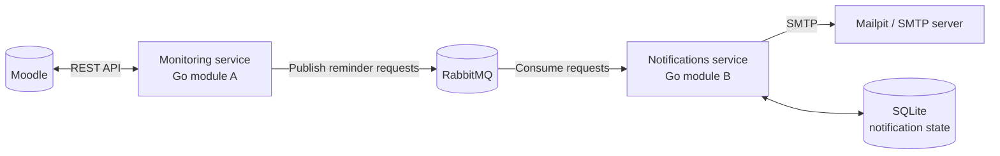
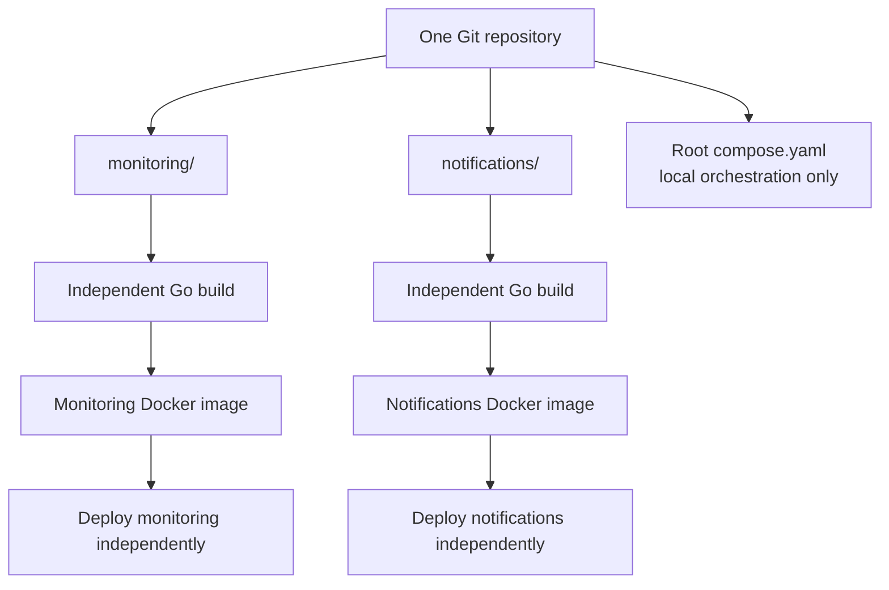
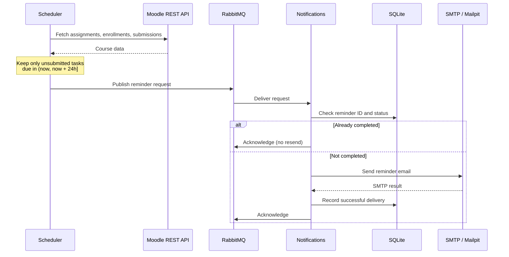

# Moodle Student Reengagement — Architecture

## Overview

This project implements a student reengagement service integrated with Moodle. It detects individual assignments due within the next 24 hours that a student has not submitted, then requests an email reminder.

The system consists of **two independently buildable and deployable microservices in one Git repository**. The services communicate asynchronously through RabbitMQ. Docker Compose provides a convenient local integration environment, but neither service depends on Compose for deployment.

> **Source and design choices:** The two services, Moodle REST integration, RabbitMQ, SMTP/Mailpit, and the 24-hour reminder rule come from the course specification. Separate Go modules, per-service Dockerfiles, SQLite persistence, and independent CI are proposed implementation choices, not explicit requirements.

## System architecture



### Service responsibilities

**Monitoring**
- Periodically queries Moodle (normally hourly; configurable for demonstrations).
- Retrieves assignments, enrolled students, and submission states.
- Identifies pending individual assignments with deadlines in the next 24 hours.
- Publishes reminder requests to RabbitMQ.
- Does not send email or access the notifications database.

**Notifications**
- Consumes reminder requests from RabbitMQ.
- Checks a stable identifier derived from course, assignment, and student to prevent resending completed reminders.
- Formats and sends reminder emails through SMTP.
- Records outcomes and handles failed processing and retries.
- Does not query Moodle.

### Moodle APIs

| Moodle function | Purpose |
| --- | --- |
| `mod_assign_get_assignments` | Retrieve assignments and deadlines |
| `core_enrol_get_enrolled_users` | Retrieve enrolled students |
| `mod_assign_get_submissions` | Identify submitted assignments |

API permissions, user email visibility, and actual response formats must be verified against the Moodle instance used.

## Repository structure

```text
moodle-reengagement/
├── monitoring/
│   ├── go.mod
│   ├── go.sum                  # created when dependencies are resolved
│   ├── Dockerfile
│   ├── cmd/
│   │   └── main.go
│   └── internal/
│       ├── moodle/             # Moodle REST client
│       ├── scheduler/          # periodic polling
│       └── publisher/          # RabbitMQ producer
│
├── notifications/
│   ├── go.mod
│   ├── go.sum
│   ├── Dockerfile
│   ├── cmd/
│   │   └── main.go
│   └── internal/
│       ├── consumer/           # RabbitMQ consumer
│       ├── email/              # SMTP delivery
│       └── persistence/        # idempotency and delivery records
│
├── contracts/
│   └── reminder-request.schema.json  # optional shared message specification
├── .github/
│   └── workflows/
│       ├── monitoring.yml
│       └── notifications.yml
├── compose.yaml
├── .gitignore
└── README.md
```

Each service owns its dependencies, executable, Dockerfile, and tests. **Neither service imports the other's implementation.** The optional contract file documents the RabbitMQ payload without requiring a shared Go package.

## Build and deployment boundaries



Initialize the two modules separately (replace the GitHub repository path if necessary):

```bash
mkdir -p moodle-reengagement/{monitoring,notifications}
cd moodle-reengagement
git init
(cd monitoring && go mod init github.com/htaschne/moodle-reengagement/monitoring)
(cd notifications && go mod init github.com/htaschne/moodle-reengagement/notifications)
```

Build the binaries independently after adding their `main.go` files:

```bash
(cd monitoring && go build ./cmd)
(cd notifications && go build ./cmd)
```

Build the container images independently after adding their Dockerfiles:

```bash
docker build -t moodle-monitoring ./monitoring
docker build -t moodle-notifications ./notifications
```

A root `compose.yaml` will start RabbitMQ, Mailpit, and both services together for local integration tests. Moodle may run in that stack or be an externally provided test instance. Production or independent deployment can use the same service images without Compose.

## Message contract

The monitoring service publishes a self-contained request. An illustrative payload is:

```json
{
  "id": "course-12-assignment-45-student-78",
  "course_id": 12,
  "assignment_id": 45,
  "student_id": 78,
  "student_email": "student@example.com",
  "assignment_name": "Final Assignment",
  "deadline": "2026-11-20T23:59:00-03:00",
  "assignment_url": "https://moodle.example/mod/assign/view.php?id=123"
}
```

The exact schema, versioning policy, queue names, and link generation should be confirmed during implementation.

## Reminder processing flow



**Reliability note:** The consumer should acknowledge a message only after the relevant processing result is durable. Failures should be recorded and retried with bounded backoff or a dead-letter strategy. A crash after SMTP accepts an email but before the database records success can still cause a duplicate on retry: ordinary SMTP plus a local database does **not** guarantee exactly-once delivery. We should explicitly document and test the chosen behavior.

## Scope and acceptance criteria

The initial implementation handles **one Moodle course**, individual assignments visible to the class, a single deadline per assignment, and at most one completed reminder per student/assignment. Group submissions, individualized extensions, a custom UI, and channels other than email are out of scope. Assignments without a deadline, already overdue, or already submitted are ignored.

| Scenario | Expected result |
| --- | --- |
| Unsubmitted assignment due within 24 hours | Reminder sent |
| Already submitted assignment | No reminder |
| Deadline outside the next 24 hours | No reminder |
| Reprocessing an already completed request | No new reminder |
| Delivery/processing failure | Failure recorded and retry attempted |

Use fictitious student accounts and Mailpit for acceptance tests.

## CI and ownership

Two independent GitHub Actions workflows can run tests and build images only when the corresponding service or its workflow changes. Changes to the message contract should trigger validation for **both** services. Each service can be versioned and released independently, even though Git history is shared.

## Delivery milestones

| Date (2026) | Checkpoint |
| --- | --- |
| October 9 | Demand gathering and questions to the partner |
| November 6 | Full-flow validation and adjustments |
| November 20 | Source code, documentation, test evidence, and presentation |

The final deliverable is a **public GitHub repository** containing both services, an installation/use guide, and test records; the course also requires an individual extension report.

## Design principles

1. **One repository, two services:** a monorepo does not imply a monolith.
2. **Independent Go modules:** no shared dependency graph is required.
3. **Independent Docker images:** build and deploy either service without rebuilding the other.
4. **Communication through contracts:** RabbitMQ is the runtime boundary; no direct imports between services.
5. **Data ownership:** only notifications owns its delivery-state database.
6. **Compose for integration:** orchestration is separate from service identity.
7. **Prefer the smallest correct solution:** prioritize the specified behavior and demonstrable failure handling over unnecessary infrastructure.
