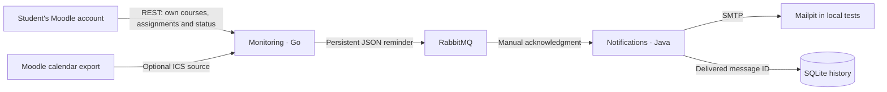

# Architecture

Noodle has two independently buildable services. Monitoring polls Moodle; Notifications delivers email. RabbitMQ is the only communication channel between them.

## Personal authorization

One worker reads one student's credentials from its environment. `MOODLE_SOURCE=api` authenticates the account, discovers its courses, filters individual assignments due within 24 hours, and calls `mod_assign_get_submission_status` with Moodle's current-user default. Pending reminders go only to `NOTIFICATION_EMAIL`. No class roster or other student's submission is requested. Multiple students can run separately configured workers against the same notification pipeline; their Moodle user IDs distinguish messages. This is not a hosted account-registration system.

`MOODLE_SOURCE=ical` reads the secret calendar export URL without API credentials. Calendar data cannot distinguish submitted from pending work. `auto` preserves calendar-first selection when a URL is configured. Failures are retried on the next poll and do not change data sources.

## Message and delivery

The existing JSON contract contains a course ID, assignment ID, student ID, recipient email, assignment name, activity URL, and UTC deadline. API identity is `course:assignment:student`; calendar events use positive synthetic IDs compatible with the same contract.

Monitoring publishes persistent messages and waits for RabbitMQ confirmation. Notifications validates the message, checks the persisted delivered-ID history, sends through SMTP with bounded retries, records success, and acknowledges processing. Duplicate completed IDs are acknowledged without sending. Invalid messages or exhausted delivery failures are rejected without requeue; failures are logged. No dead-letter or indefinite retry infrastructure is introduced.

The SMTP send and SQLite write are not one transaction. A crash between them can cause a duplicate delivery after replay. Normal reprocessing and process restarts are covered by the stored history. Calendar changes/cancellations cannot retract messages already queued or emails already sent.

## Test boundary

The acceptance suite uses a fictional Moodle REST server with the production monitoring cycle, a real RabbitMQ broker, the real Notifications container, and Mailpit SMTP. It tests delivery, exclusions, persisted duplicate suppression after restarts, and recovery from a Mailpit Chaos SMTP error. It does not claim to provision a real Moodle instance. Read-only PUCRS checks separately verify the personal API response format and access.
