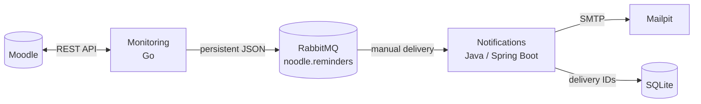

# Architecture

## Overview

Noodle is a pair of asynchronous workers. Monitoring reads Moodle and publishes reminder requests. Notifications consumes those requests, sends email through SMTP, and persists successful message IDs for deduplication. Neither service exposes an HTTP endpoint or imports code from the other.



Docker Compose provides the local deployment topology. Moodle remains external to the stack.

## Service boundaries

### Monitoring

Monitoring is a long-running Go process. It starts a cycle immediately, then waits for `MONITOR_INTERVAL` before starting the next cycle. Each cycle:

1. Authenticates with Moodle using a username, password, and service name.
2. Retrieves site information and discovers every course visible to the authenticated user.
3. Retrieves assignments for each course.
4. Keeps individual assignments with submissions enabled and a standard deadline in `(now, now + 24 hours]`.
5. Retrieves enrolled users and submission records only for courses and assignments that pass the deadline filter.
6. Identifies candidates only when student role and incomplete submission state are explicit.
7. Publishes the resulting reminder requests to RabbitMQ.

Student roles are classified from Moodle role names. Mixed student and staff roles are treated as staff, while missing or unknown roles are ambiguous. Submission states `new`, `draft`, and `reopened` are incomplete; `submitted` is complete. Missing records, unknown states, conflicting records for the same attempt, and submission warnings do not produce candidates.

The service fails closed when Moodle data is unavailable or ambiguous. Assignment warnings and skipped data mark the cycle's reported coverage as partial. When a cycle produces no candidates, Monitoring does not connect to RabbitMQ.

Monitoring performs read-oriented Moodle calls only. It does not update Moodle or send email.

### Notifications

Notifications is a Spring Boot worker. It validates each message, checks SQLite for the deterministic message ID, and sends a plain-text reminder through SMTP. The email contains the assignment name, due time, and an instruction to submit through Moodle; no assignment URL is generated.

After SMTP accepts the email, Notifications inserts the message ID into the `delivered_notifications` table. The primary-key constraint prevents a recorded ID from being stored twice and the Compose volume preserves the database across restarts.

RabbitMQ acknowledgments are manual:

- Successful deliveries are acknowledged after the SQLite record is written.
- Previously recorded IDs are acknowledged without another email.
- Invalid messages are rejected without requeue.
- SMTP or persistence failures are rejected without requeue after processing fails.

SMTP delivery is attempted up to three times with a 500 ms delay. There is no dead-letter queue.

## Moodle integration

Monitoring sends form-encoded HTTP `POST` requests and expects JSON responses. The HTTP client has a 30-second timeout.

| Endpoint or function | Purpose |
| --- | --- |
| `/login/token.php` | Obtain a web-service token |
| `core_webservice_get_site_info` | Resolve the authenticated Moodle user |
| `core_enrol_get_users_courses` | Discover the user's courses |
| `mod_assign_get_assignments` | Retrieve course assignments and deadlines |
| `core_enrol_get_enrolled_users` | Retrieve users, roles, and email addresses |
| `mod_assign_get_submissions` | Retrieve per-assignment submission states |

Monitoring obtains a new token during every cycle. Moodle credentials and tokens are redacted from API errors and warnings; reminder payloads and email addresses are not logged by application code.

## RabbitMQ topology

Both services declare one durable queue named `noodle.reminders`. Monitoring publishes to RabbitMQ's default exchange with `noodle.reminders` as the routing key. Messages are marked persistent, and Monitoring waits for a publisher confirmation before counting a publication as successful.

The JSON contract is defined by Monitoring and consumed directly by Notifications:

```json
{
  "id": "95406:123456:42",
  "course_id": 95406,
  "assignment_id": 123456,
  "student_id": 42,
  "email": "student@example.test",
  "assignment_name": "Trabalho 2",
  "due_at": "2026-10-31T15:00:00Z"
}
```

The message ID is deterministic: `course_id:assignment_id:student_id`.

## Delivery guarantees

RabbitMQ publication is confirmed, message consumption uses manual acknowledgments, and successful IDs persist in SQLite. These mechanisms provide durable handoff and restart-safe duplicate suppression for recorded deliveries, but they do not provide exactly-once email delivery.

SMTP acceptance and the SQLite insert are separate operations. A process failure after SMTP succeeds but before SQLite records the ID can cause a duplicate if the message is delivered again. Conversely, a message that exhausts its SMTP retries is rejected without requeue because no dead-letter topology is configured.

## Local deployment

The root `compose.yaml` runs four services:

| Service | Local exposure | Persistence | Dependencies |
| --- | --- | --- | --- |
| `rabbitmq` | `127.0.0.1:5672`, `127.0.0.1:15672` | `rabbitmq_data` | — |
| `monitoring` | None | None | Healthy RabbitMQ |
| `mailpit` | `127.0.0.1:8025`; SMTP `1025` is internal | None | — |
| `notifications` | None | `notifications_data` | Healthy RabbitMQ, started Mailpit |

Compose rewrites Monitoring's RabbitMQ host to `rabbitmq`, configures Notifications to use `rabbitmq:5672` and `mailpit:1025`, and stores its SQLite database at `/data/notifications.db`.

Monitoring and Notifications retain separate dependency manifests, Dockerfiles, images, and runtime processes. Compose is local orchestration rather than a build-time dependency between them.
